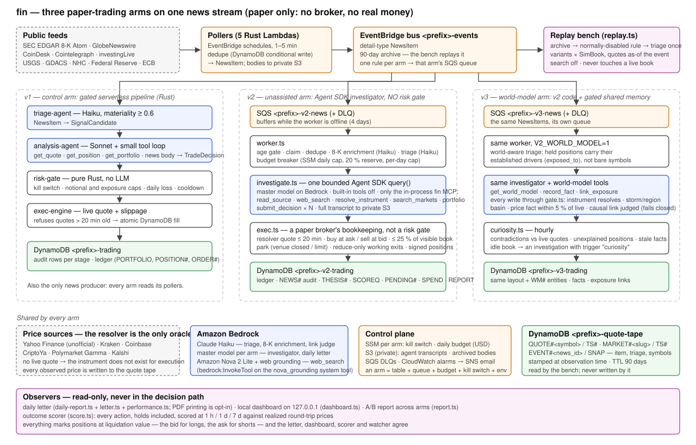

# Agentic news investigator on Amazon Bedrock: measuring LLM trading judgment with paper trading

A reference implementation for measuring an LLM's trading *judgment* on live news, with
paper trading on Amazon Bedrock. Public feeds (SEC filings, press wires, disaster and macro
sources) flow onto one event bus; three independent **arms** read the same stream and make
simulated trades into their own ledgers — a rule-gated serverless pipeline, an unassisted
Agent SDK investigator with no risk gate, and the same investigator with a gated shared world
model. Every decision, including the trades *not* taken, is scored against what prices did
next; a daily letter, a local dashboard and an A/B report compare the arms; and a replay bench
re-runs an archived window with as-of quotes and a simulated book so prompts, models and
strategies can be compared on identical inputs.

> **Notice — read before deploying**
>
> - **Paper trading only.** There is no broker, no exchange connectivity and no real money in
>   the trading path. Fills are DynamoDB rows against live public quotes.
> - **Not investment advice.** Nothing this system produces is a recommendation. It is a
>   research instrument for studying model judgment.
> - **Non-production sample code.** This is sample code, for non-production usage. You
>   should work with your security and legal teams to meet your organizational security,
>   regulatory and compliance requirements before deployment. One operator, one account,
>   best-effort support. Read [`docs/THREAT_MODEL.md`](docs/THREAT_MODEL.md) before running
>   it anywhere that matters.
> - **LLM spend is real money.** The model calls behind every investigation, triage and letter
>   are billed to your AWS account. The code has a spend breaker, a kill switch and a dry-run
>   default; read [`docs/COST.md`](docs/COST.md) and set a budget before you start a worker.

## Architecture



In ten lines:

1. Five Rust Lambdas poll public feeds and publish `NewsItem` events on an EventBridge bus with a 90-day archive.
2. **v1** — the control arm — is a serverless Rust pipeline: Haiku triage → Sonnet analysis → a deterministic **risk gate** (no LLM) → simulated fills.
3. **v2** — the unassisted arm — is a long-running TypeScript worker: filing enrichment → Haiku triage → a spend breaker → one bounded **Agent SDK investigation** per event (a master model on Bedrock with only in-process tools) → any number of `submit_decision` calls → a paper broker.
4. v2 has **no risk gate by design**; its only hard limits are physics: a live quote from the deterministic resolver, cash never negative, no leverage, fills capped to 25 % of a visible order book, and the daily LLM budget.
5. **v3** — the world-model arm — runs the same code with `V2_WORLD_MODEL=1`: a typed, **gated** shared memory (instruments, storms, regions, exposure links) plus an hourly curiosity loop; v2 stays the control.
6. An **arm** is a table, a queue, a budget, a kill switch and an env block; the master model is set per arm, so adding a model is adding an arm.
7. The **resolver** is the only price oracle (Yahoo, Kraken, Coinbase, CriptoYa, Polymarket, Kalshi); what it cannot price does not exist for execution, and every price it returns is written to a shared **quote tape** at observation time.
8. Every action — holds included, as counterfactual buys — is **scored** at 1 h / 1 d / 7 d against realized round-trip prices; all marks are at liquidation value (bid for longs, ask for shorts).
9. The **daily letter**, **dashboard** and **A/B report** are read-only observers; nothing they produce feeds back into decisions.
10. The **bench** replays the archive through the same triage and one or more decision-layer variants, each against its own simulated book, with quotes as-of the event and web search off (no lookahead).

Full detail: [`docs/ARCHITECTURE.md`](docs/ARCHITECTURE.md).

## Leaderboard

`npm run leaderboard` (in `v2/`) ranks your arms — return on seed, excess over SPY, max
drawdown, hit rates, LLM spend — marking every book at liquidation value exactly as the
dashboard and the letter do, and writes `leaderboard/` (json, markdown, equity SVG, badges)
plus the block below. The shipped block is empty: results are your own deployment's.

<!-- leaderboard:start -->
*No results yet — run `npm run leaderboard` against a deployment.*
<!-- leaderboard:end -->

## Repository layout

| Path | What |
|---|---|
| `crates/`, `lambdas/` | v1: Rust workspace — pollers, triage, analysis, risk gate, execution, digest (one binary crate per Lambda) |
| `infra/` | the CDK stack (TypeScript): bus, archive, pollers, v1 pipeline, per-arm queues/tables/parameters, replay path, tape, private bucket, alarms |
| `v2/src/` | v2 and v3: the worker, investigator, tools, resolver, paper broker, watcher, scorer, tape, bench, letter, dashboard, A/B report |
| `v2/dashboard/` | the dashboard's static page (no front-end dependencies) |
| `v2/test/` | vitest suites: pure modules and recorded fixtures |
| `arms.json` | the arms registry — the shipped default *is* the reference experiment (v1, v2, v3) |
| `ops/` | supervisor templates: launchd, systemd, Docker Compose |
| `scripts/` | seed and kill-switch helpers |
| `docs/` | architecture, cost, threat model, operations, benchmark, roadmap, third-party notices, an example letter |

## Quickstart

### Prerequisites

- An AWS account with **Amazon Bedrock model access enabled** for the Anthropic Claude models
  named in `arms.json` / `infra/lib/fin-stack.ts` (Haiku for triage, Sonnet for the v1
  analysis agent, the master model for the investigator) **and for Amazon Nova 2 Lite**
  (web grounding), in the deployment region and the regions its cross-region inference
  profiles route to.
- AWS CLI v2 with credentials for that account; AWS CDK v2 CLI (`npm i -g aws-cdk@2.1142.0`, the version
  `infra/package.json` pins; `npx cdk` inside `infra/` uses that copy without a global install) and a
  bootstrapped environment (`cdk bootstrap`).
- **Node.js ≥ 20** and npm.
- A **Rust** stable toolchain and **`cargo-lambda`** (the stack builds the Lambdas for arm64
  with `cargo lambda build`, `infra/lib/rust-function.ts`; without it on PATH the build runs in
  the `ghcr.io/cargo-lambda/cargo-lambda` Docker image, pinned by digest).
- Optional, for the letter's PDF and DOCX: `pandoc`, `weasyprint`, and a CUPS printer if you
  want it printed.

### 1. Deploy the stack

```bash
cd infra && npm install
npx cdk deploy -c contactEmail=you@example.com -c prefix=fin
```

`contactEmail` is **required** on every deploy: it is the SEC EDGAR fair-access contact for
the poller and the address the alarms email. `prefix` names every resource (default `fin`);
the `-c prefix=` context and the `ArmsEnv` output are added by the infrastructure package. Note
the outputs — queue URLs, table names, the transcript bucket, the SSM parameter names, the
tape table — you will paste them into the worker's environment.

Two optional context values govern the pipeline Lambdas' logs: `-c logLevel=` sets `RUST_LOG`
on every Rust Lambda (`error|warn|info|debug|trace`, default `warn`: errors, dropped orders,
risk-gate limit refusals and kill-switch trips; `info` adds per-event progress), and
`-c logRetentionDays=` sets the retention of their CloudWatch log groups (default `30`; any
value CloudWatch accepts, e.g. 7, 14, 90, 365).

### 2. Seed an arm

Each arm starts with a cash balance and an inception timestamp:

```bash
cd v2 && npm run seed -- --arm v2 --cash 100000 --apply   # an agent arm (dry-run without --apply); writes PORTFOLIO/SNAPSHOT + STATE/INCEPTION
../scripts/seed-portfolio.sh 100000            # v1's table
```

Seeding is a conditional write; it refuses to overwrite an existing book.

### 3. Run a worker

```bash
cd v2 && npm install
npm run build && npm test && npm run compile   # typecheck, tests, emit dist/

# Run as an identity holding the stack's WorkerPolicy (output WorkerPolicyArn), not as an
# administrator: it grants exactly what the worker needs (ops/README.md, "Credentials").

export AWS_REGION=us-east-1
export V2_ARM=v2
export V2_QUEUE_URL=<FinStack.V2QueueUrl>
export V2_TRANSCRIPT_BUCKET=<FinStack.V2TranscriptsBucket>
export V2_EDGAR_CONTACT=you@example.com        # SEC fair access; a real address
export V2_DRY_RUN=true                         # decide and audit, never fill — start here

npm run worker                                 # hand run (tsx). For anything longer, run dist/worker.js under a supervisor
```

Watch the log: one line per news item, one per investigation with turns and cost. When you
are satisfied, set `V2_DRY_RUN=false` and restart. Set the arm's daily budget first:

```bash
aws ssm put-parameter --name /fin/v2/daily-budget-usd --value 25 --overwrite
../scripts/kill-switch.sh --arm v2 status      # on | off | status; omit --arm for the pipeline arm
```

For a world-model arm, run a second worker with `V2_ARM=v3 V2_WORLD_MODEL=1` and v3's queue,
table and parameters. Supervisor templates and the restart rules are in
[`docs/OPERATIONS.md`](docs/OPERATIONS.md) and [`ops/README.md`](ops/README.md).

### 4. Open the dashboard

```bash
npm run dashboard                              # http://127.0.0.1:4310 (compiled JS — compile first; dashboard:dev uses tsx)
```

Read-only, loopback only: every arm's book at liquidation value, the equity curve against
SPY/QQQ/GLD/USO, spend against budget, orders, the news flow, the investigation feed, outcome
scores, theses and the letters.

### 5. Read the letter

```bash
npm run daily-report                           # v2/reports/<day>.md (+ .docx and a narrative PDF when pandoc / weasyprint are installed)
REPORT_DAY=2026-01-15 npm run daily-report     # regenerate an old day without moving the window anchor
npm run report                                 # the A/B comparison across arms, as text
```

Each letter covers everything since the previous letter's window ended. Printing is opt-in
(`V2_PRINT=1`). A redacted example is in [`docs/example-letter.md`](docs/example-letter.md).

## Add an arm / plug in a model

An arm is one object in `arms.json`:

```json
{
  "key": "v4",
  "kind": "agent",
  "label": "Sonnet, terse",
  "model": "us.anthropic.claude-sonnet-4-6",
  "effort": "medium",
  "worldModel": false,
  "dailyBudgetUsd": 25,
  "maxInvestigationsPerDay": 50
}
```

Then: `cdk deploy` (creates the arm's queue, table, kill switch and budget), seed it
(`npm run seed -- --arm v4 --cash 100000`), and start a worker with `V2_ARM=v4` and the arm's
env block from the `ArmsEnv` output. The report, dashboard and letter pick the new arm up from
the registry. The registry, `npm run seed` and the registry-aware report/dashboard are added by
the runtime package; environment variables always override the registry's defaults.

Two constraints today: the master model must be an **Anthropic model on Bedrock** that the
pinned `@anthropic-ai/claude-agent-sdk` knows (a newer model fails silently as zero-confidence
holds until the SDK is upgraded), and Bedrock access for it must be enabled in your account. A
Converse adapter for other vendors is on the [roadmap](docs/ROADMAP.md). Prompt or structure
variants that do not need a new arm go through `v2/src/strategy.ts` and are compared on the
bench.

## Run the bench

```bash
cd v2
npm run replay -- --name bench-baseline --max 20 --days 7 --end-days-ago 7 --variants live,no-mandate
```

The bench drains a filtered EventBridge replay of the archive, triages each event once, runs
each variant chronologically against its own simulated book with quotes **as-of the event**,
scores 1 d / 7 d outcomes from history, and writes one `BENCHSUM` row per variant. Web search
is off (the live web knows the future); primary sources are on. Always pass `--days` and
`--end-days-ago`; `--max` and `--budget-usd` are per variant. The corpus-based `npm run
bench` / `bench:build` / `bench:dump` / `bench:compare` commands, building a corpus from public sources, and
a statement of what the bench can and cannot claim are in
[`docs/BENCHMARK.md`](docs/BENCHMARK.md) (added by the bench package).

## Cost

At 2026 list prices an investigator arm that runs 100 or more investigations a day costs
**tens of dollars a day** in model calls; a quiet day is a few dollars, and a storm-advisory
day hits whatever ceiling you set. AWS infrastructure is pennies to a few dollars a month.
The breaker (a per-arm daily budget in SSM with a 20 % reserve for position management, a
per-day investigation cap, per-run caps), the kill switch and every lever for capping spend are
in [`docs/COST.md`](docs/COST.md).

## Third-party services and notices

The sample reads SEC EDGAR (fair-access policy: a real contact is required), Yahoo Finance
(**unofficial endpoints**, off by default), Kraken, Coinbase,
CriptoYa, Polymarket, Kalshi, USGS, GDACS, NOAA NHC, Federal Reserve and ECB feeds and several
publisher RSS feeds, and invokes Anthropic models and Amazon Nova web grounding on Amazon
Bedrock. It depends on `@anthropic-ai/claude-agent-sdk`, which is **proprietary** and cannot be
removed today. Several feeds' terms restrict automated access or use with AI systems; Kalshi,
CoinDesk and Cointelegraph expressly prohibit what the sample does with them. Each provider's
terms as reviewed on 2026-10-07 are in [`docs/THIRD_PARTY_NOTICES.md`](docs/THIRD_PARTY_NOTICES.md).
Yahoo Finance, Kalshi, Polymarket, Coinbase and the GlobeNewswire, investingLive and
CoinDesk/Cointelegraph feeds therefore ship **off**; some are off only because their terms could
not be reviewed. Out of the box the sample reads SEC EDGAR, USGS, NOAA NHC, GDACS, the Fed and
the ECB, and prices against Kraken and CriptoYa. Turn a source on with `-c enableSources=…` and `V2_ENABLE_SOURCES=…` only if you hold the provider's
permission, or plug in a licensed feed instead; both are covered in
[OPERATIONS.md § 11](docs/OPERATIONS.md#11-opt-in-data-sources). Read the remaining terms
before you deploy.

## Security

See [`SECURITY.md`](SECURITY.md) for how to report a vulnerability and
[`docs/THREAT_MODEL.md`](docs/THREAT_MODEL.md) for assets, trust boundaries, the mitigations
that exist in code (spend breaker and reserve, kill switch, no broker, liquidity cap,
reduce-only working orders, tools only through the in-process MCP server with built-ins
disabled, Zod-validated tool inputs, least-privilege Lambda roles, bench isolation) and the
residual risks (prompt injection through news and filings can steer *paper* decisions;
unofficial market-data endpoints; transcripts in a private bucket contain model reasoning).

An **Amazon Bedrock guardrail** (`infra/lib/guardrail.ts`) is a second layer under the
investigator's content-is-data prompt rule. Its content filters include prompt-attack
detection on input. It also carries the managed profanity list and output-only PII
anonymisation, and an alarm fires on every intervention. The stack always creates it.
v1 uses it unless deployed with `-c guardrail=off`. The agent arms use it only when
`V2_GUARDRAIL_ID` and `V2_GUARDRAIL_VERSION` are set (stack outputs `GuardrailId` /
`GuardrailVersion`). With them set:

- Triage, filing summaries and the v3 link judge send only the untrusted text as guard content.
- The investigator names the guardrail on every model call; a block becomes an audited hold.
- `read_source` and `web_search` results pass `ApplyGuardrail` before the agent reads them. This step fails open.

Benchmark it first with the `guardrail` bench variant ([`ops/README.md`](ops/README.md#bedrock-guardrail)).
It is billed per 1,000 characters evaluated, and the investigator is evaluated over its whole
input on every turn: about $0.30–$0.55 per investigation ([`docs/COST.md`](docs/COST.md#guardrail-costs)).

## Documentation

| Document | Contents |
|---|---|
| [`docs/ARCHITECTURE.md`](docs/ARCHITECTURE.md) | event flow, the one-decision-path rule, resolver, execution rules, tape and as-of bench, world-model gate, table layout, search and permissions (IAM) |
| [`docs/COST.md`](docs/COST.md) | what costs money, the breaker, typical figures, how to cap |
| [`docs/OPERATIONS.md`](docs/OPERATIONS.md) | running the workers, the letter, the dashboard, kill switch and budgets, failure signatures |
| [`docs/BENCHMARK.md`](docs/BENCHMARK.md) | the reproducible bench: corpus, compare, what it can and cannot claim |
| [`docs/THREAT_MODEL.md`](docs/THREAT_MODEL.md) | security review input |
| [`docs/THIRD_PARTY_NOTICES.md`](docs/THIRD_PARTY_NOTICES.md) | services, terms, dependency notices |
| [`docs/ROADMAP.md`](docs/ROADMAP.md) | what the reference implementation does not do yet |
| [`docs/example-letter.md`](docs/example-letter.md) | one redacted daily letter |
| [`docs/postmortems/`](docs/postmortems/) | an incident write-up that shaped the design |

## Development

```bash
# v2 / v3 (cd v2): Node ≥ 20, ESM, vitest. `build` is the typecheck; there is no linter.
npm run build && npm test && npm run compile
npx vitest run test/exec.test.ts -t "liquidity"

# v1 (repo root): Rust workspace
cargo test --workspace
cargo lambda build --release --arm64

# infra
cd infra && npx cdk diff -c contactEmail=you@example.com -c prefix=fin
```

## Licence

This sample is licensed under the MIT-0 License. See the [LICENSE](LICENSE) file.

## Support

This is sample code accompanying a blog post, maintained on a best-effort basis. Open an
issue for bugs or questions; expect a first response within **five business days**. Pull
requests are welcome — see [CONTRIBUTING.md](CONTRIBUTING.md). Material changes to the
security posture go through review before release.
