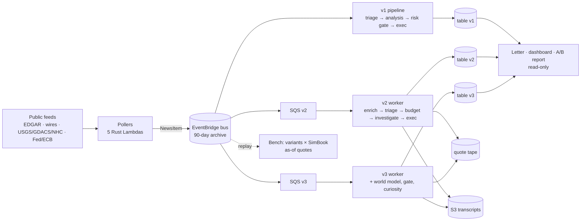

# Architecture

How the sample works, which rules the code enforces, and where each piece lives. This is
the reference for the blog post and for anyone who wants to plug in a model or a prompt
strategy and compare it on the same news. Everything here is **paper trading**: the only
real money in the system is the LLM spend, and the only thing the code can buy is a
DynamoDB row.




## 1. The three arms

An **arm** is a table, a queue, a budget, a kill switch and an environment block. All arms
read the same `NewsItem` stream; none of them shares state with another.

| Arm | Code | Decision layer | Guardrails | Role |
|---|---|---|---|---|
| **v1** | `crates/`, `lambdas/`, `infra/` (Rust, serverless) | Haiku triage → Sonnet analysis with a small tool loop | deterministic **risk gate** (no LLM): per-order and per-position notional caps, gross-exposure cap, daily-loss cap, per-symbol cooldown, minimum confidence, kill switch | control arm; also the **only news producer** |
| **v2** | `v2/src` (TypeScript, long-running worker) | Agent SDK investigator (master model on Bedrock) with tools; any number of actions per event | **no risk gate by design** — only a paper broker's bookkeeping and the LLM spend breaker | the unassisted arm the experiment measures |
| **v3** | same `v2/src`, `V2_WORLD_MODEL=1`, `V2_ARM=v3` | same investigator plus a typed, **gated** shared world model and an hourly curiosity loop | same as v2 | tests whether gated shared memory improves judgment; v2 stays the control |

The experiment's question is *judgment*, so v2 and v3 are deliberately not protected from
their own decisions. Everything they can do is bounded by physics, not policy: a fill needs a
live quote from a deterministic resolver, cash cannot go negative, short exposure cannot
exceed book equity, a fill cannot take more than a quarter of a visible order book, and the
day's LLM spend cannot exceed an SSM parameter.

## 2. Event flow (v2 / v3)

```
pollers ─► NewsItem on the bus ─► per-arm SQS queue ─► worker.ts
   drop if older than V2_MAX_NEWS_AGE_HOURS (6)
   claimNews (idempotent: one arm processes one id once)
   dedupe (recent.ts: exact headline, and storm-advisory cycles)
   8-K enrichment (enrich.ts: fetch the filing by accession, Haiku summary)
   triage (triage.ts: Haiku → materiality, event_type, touches_positions, hypotheses)
   budget check (budget.ts: daily USD cap, per-day investigation cap, 20% reserve)
   investigateAndAct (pipeline.ts)
      book context ─► investigate.ts (Agent SDK query, fin MCP tools only)
      for each submitted action: outcome score enqueued, thesis recorded,
      exec.executeDecision → filled | parked | dropped
      v2-decision audit row written last
periodic passes in the same loop:
   score.scorePass    every 15 min   (1h / 1d / 7d outcome scores)
   watch.watchPass    every 5 min    (position alerts, settlement, daily review, parked orders)
   curiosity.curiosityPass  hourly   (v3 only)
```

**Enrichment.** An EDGAR 8-K arrives from the poller as metadata only (form, filer, CIK,
item codes, accession, size). `enrich.ts` fetches the full submission by accession through
`read_source`, and the triage model writes a two-to-three-sentence summary with item codes
and the cover-page ticker, appended to the item as `Filing summary:` and merged into
`tickers_hint`. It has a 20 s deadline, at most four concurrent SEC reads (fair access), and
never throws — on any failure triage sees the bare entry. The bench runs the same step.

**Triage.** One Haiku call returns strict JSON: `materiality` 0–1, `event_type`, `regions`,
`touches_positions`, `hypotheses` (instrument + direction + mechanism, or empty), and a
rationale. An item is investigated at `V2_TRIAGE_THRESHOLD` (0.45), or at
`V2_HELD_TRIAGE_THRESHOLD` (0.35) when it touches a held position. Triage also receives the
last few hours of investigations so routine updates of a story already decided score low.
In v3, held positions are passed as `{symbol, label, exposed_to}` so "touches" means a
recorded driver, not a resemblance.

**Budget.** `budget.ts` is the one hard breaker: a daily USD ceiling read from SSM
(`/<prefix>/<arm>/daily-budget-usd`, cached 60 s), a per-day investigation cap
(`V2_MAX_INVESTIGATIONS_PER_DAY`), and a reserve: news investigations stop at 80 % of the
ceiling, and only position management (alerts, the daily review, curiosity) may spend the
last 20 %, so news spam can never blind the agent to a position that is moving. Spend is
tallied per UTC day under `SPEND / DAY#<day>`; the grounded-search cost of each investigation
is folded in. Each run is additionally capped by `V2_MAX_BUDGET_PER_RUN_USD` (3) and
`V2_MAX_TURNS` (15).

## 3. One decision path for every trigger

`pipeline.ts` `investigateAndAct(item, hypotheses, web)` is the only way a decision is made.
Four callers synthesize a `NewsItem` and hand it over:

| Trigger | `source_family` | Raised by |
|---|---|---|
| news | the poller's family (`edgar`, `prwire`, `crypto`, `disasters`, `macro`) | the SQS loop |
| position alert | `position-watch` | `watch.ts`, on a ±5 % leg (±10 % for prediction contracts) since the last reference price, on the liquidation side of the book, with a 4 h cooldown per symbol |
| daily review | `daily-review` | `watch.ts`, once a day at `V2_REVIEW_HOUR_UTC` (13), deferred while every position was re-underwritten within the last 60 min, up to 3 h; runs on an empty book too |
| curiosity | `curiosity` | `curiosity.ts` (v3): the world model's worst open issue |

Because of this, every decision — whatever raised it — is audited, thesis-recorded,
outcome-scored and executed identically. New triggers must go the same way; nothing else may
call `investigate()` or `executeDecision()`.

## 4. The investigator

`investigate.ts` runs **one bounded Agent SDK `query()`** per event:

- the master model on Bedrock (`V2_MASTER_MODEL`), routed through Bedrock with
  `CLAUDE_CODE_USE_BEDROCK=1`; reasoning depth from `V2_EFFORT`;
- **all built-in tools disabled** (`Bash`, `Read`, `Write`, `Edit`, `Glob`, `Grep`,
  `WebFetch`, `WebSearch`, `Task`, …) and `allowedTools` restricted to the in-process `fin`
  MCP server — the agent's whole world is `tools.ts`;
- `maxTurns` and `maxBudgetUsd` from config; a session-context line (US equity session, FX
  session, futures session) because the model has no clock;
- the book context from `pipeline.ts`: ledger snapshot, deployment mandate and utilization,
  the 72 h watchlist of instruments earlier holds named, standing theses per held symbol,
  parked and working orders, and (v3) the world model's view of the held book;
- the complete transcript written to the private S3 bucket under `transcripts/<arm>/<day>/`.

If the loop ends without a `submit_decision` call the result is a zero-confidence hold.
`submit_decision` may be called any number of times; that is how multi-action decisions
happen (a sell and a buy, a trade and a watch).

Tools (`tools.ts`; schemas are plain Zod — `z.string / number / boolean / enum / array /
object` only, because the SDK cannot convert `z.record` or `z.union` and would silently
expose no tools):

| Tool | What it does |
|---|---|
| `read_source` | the event's own document: an SEC filing by accession (full submission, exhibits listed), an archived body from S3, or — live only — the event URL. Capped at 2 MB fetched / 24 k characters returned. |
| `web_search` | Amazon Nova web grounding (§ 12). Returns a grounded, cited answer, never raw pages. |
| `resolve_instrument` | the resolver (§ 5): is this tradeable, at what quote, how deep, how old |
| `search_markets` | Polymarket market discovery by text |
| `get_portfolio`, `get_positions`, `get_recent_trades`, `get_decision_history` | the book and its history |
| `submit_decision` | `buy` / `sell` / `hold`, symbol, kind, `notional_usd`, `confidence`, `rationale`, `evidence[]`, optional `limit_price` and a `watch_symbol` for holds |
| `get_world_model`, `record_fact`, `link_exposure` | v3 only; every write passes `gate.ts` |

The **deployment mandate** (`mandate.ts`) is a prompt, not a gate: the agent is a portfolio
manager with a conviction-to-size ladder, and every book context prints equity, deployed
percent against a 30–70 % band in 4–12 positions with a 10 % position cap, and the watchlist.
`strategy.ts` is the seam where a *variant* swaps the system prompt, the book-context
transform or the turn budget; the live investigator is one strategy (`live`), and the bench
runs several over the same events.

## 5. The resolver is the only price oracle

`quotes/resolver.ts` is the tradeability gate. The agent may propose any instrument, but only
a symbol the resolver can price against a live public endpoint exists for execution — the
model never invents a price.

| Kind | Symbol form | Sources (in order) |
|---|---|---|
| equity, ETF, international listing, future | `AAPL`, `7203.T`, `VOD.L`, `CL=F`, `ES=F` | Yahoo Finance chart endpoint (unofficial; delayed, futures ~10 min) |
| FX pair | `EURUSD` (any ISO-4217 pair) | Kraken book when it exists and — for liquid majors — is no wider than `V2_FX_MAX_SPREAD_BPS` (10); otherwise Yahoo's interbank reference (majors tradeable at the 2 bps adverse fill; exotic pairs *indicative only*) |
| crypto | `BTC`, `ETH`, … | Kraken → Coinbase → Yahoo (long tail) |
| parallel FX (USDT "blue" rates) | `USDTARS`, `USDTBOB` | CriptoYa: median of fresh venues, at least two per side; long only |
| prediction contract | `<polymarket-slug>:YES` / `:NO`, `<KALSHI-TICKER>:YES` / `:NO` | Polymarket Gamma / Kalshi, with resting depth |

Every quote carries `asOfMs`, `bid`/`ask` when a book exists, `liquidityUsd` when the venue
reports it, and `indicativeOnly`. Execution refuses quotes older than 20 minutes
(`maxQuoteAgeSecs`), which is how a closed venue is detected: the order parks instead.

## 6. Execution: a paper broker's bookkeeping

`exec.ts` → `ledger.ts`, mirrored exactly by the bench's `SimBook`:

1. **Re-quote deterministically** through the resolver; refuse stale quotes (→ park) and
   one-sided or empty books.
2. **Fill price**: buy at the ask, sell at the bid wherever a book exists; otherwise 2 bps
   adverse of the reference price. Prediction contracts fill in whole contracts.
3. **Agent-set limit**: the agent's own `limit_price` is honoured (limit not met → park).
4. **Liquidity cap**: a fill takes at most `V2_MAX_FILL_LIQUIDITY_FRACTION` (25 %) of the
   venue's visible resting book. Market physics, not a risk gate — a $16 book cannot absorb a
   $2,000 order. Opening fills are capped once; sizing an entry to the book is the agent's job.
5. **Working exits**: a capped fill that *reduces* a position parks its remainder as a
   **reduce-only working order** (`pending.ts`); the watcher takes another 25 %-of-book slice
   no sooner than `V2_PENDING_SLICE_MIN` (60) minutes after the last, waits through an empty
   book, stops at $1 of dust or when the position is gone, and keeps the original expiry.
   `clampReduceOnly` guarantees a working sell can never flip a long into a short.
6. **Signed positions** (`positions.ts`): qty > 0 long, qty < 0 short. A sell beyond what is
   held opens a short (equities, ETFs, futures, crypto, FX; prediction contracts use the NO
   side, parallel FX is one-sided). Cash never negative; total short exposure ≤ book equity
   (no leverage).
7. **Atomic ledger write**: one DynamoDB transaction over `PORTFOLIO/SNAPSHOT`,
   `POSITION#<symbol>` and `ORDER#<decision_id>` (the decision id doubles as the idempotency
   key).

**Parking** (`pending.ts`): an order that cannot fill because the venue is closed or the
limit is not met is stored under `PENDING#<symbol>` and retried by the watch pass until it
fills or expires after `V2_PENDING_EXPIRY_HOURS` (24, wall-clock — venue-hours-aware expiry
is on the roadmap). One pending order per symbol; a newer decision supersedes it. Parked and
working orders ride along in every later book context, so the agent learns what happened to
its orders.

**Liquidation marks everywhere.** Longs are marked at the bid, shorts at the ask
(`liquidationPrice`). The letter, dashboard, scorer, watcher and A/B report all agree; mid
marks on thin books are fiction.

**Book corrections.** `src/admin/unwind-legacy.ts` reverses rule-violating fills *at cost*
(audited as `v2-book-correction`, never a trade). It exists for fills that predate a rule and
is dry-run unless `--confirm` is passed; it is never used to erase a loss the rules allowed.

## 7. Position management and settlement

`watch.ts` runs every five minutes: re-quote each open position, and if the liquidation-side
price has moved ±5 % (±10 % prediction) since the last reference price, synthesize a
`position-watch` event and run a normal investigation whose live options are hold, add or
reduce. Books thinner than `V2_WATCH_MIN_DEPTH_USD` ($500) or wider than
`V2_WATCH_MAX_SPREAD_FRAC` (25 % of mid) are **suppressed and audited**
(`v2-watch-suppressed`, `kind: thin-book`) rather than investigated. The same pass settles
resolved prediction contracts to cash at $1 / $0 (pure bookkeeping), retries parked orders,
and runs the once-a-day whole-book review.

## 8. Outcome scores: the reward signal

`score.ts` scores **every** action at 1 h, 1 d and 7 d against realized round-trip prices
(entry at the traded side, exit at the liquidation side). Scoring is prospective — the scorer
re-resolves the instrument once each horizon has elapsed; a quote older than 30 min at scoring
time is not accepted. Holds that named a `watch_symbol` are scored as the **counterfactual
buy** of that symbol and reported separately (a hold is vindicated when the declined buy
would have returned little or lost). Items live under `SCOREQ`: `P#<decidedAt>#<newsId>`
while pending, rewritten to `D#…` when every horizon is resolved.

## 9. Memory

- **Standing theses** (`thesis.ts`, `THESIS#<symbol>`): each decision's rationale, latest
  plus a short history, pushed into later investigations that touch the symbol.
- **Recent activity** (`recent.ts`, in-memory, resets on restart): what was investigated and
  decided in the last hours (for triage), and the **watchlist** of instruments holds named and
  left, for the mandate (`V2_MANDATE_WATCHLIST_HOURS`, 72).
- **World model** (v3, § 11).

## 10. The quote tape and the as-of bench

**Tape** (`tape.ts`, table `<prefix>-quote-tape`, shared by all agent arms, TTL 90 days):
every price the system observes is persisted *when it is observed* — ingest snapshots of an
item's `tickers_hint` taken before the investigation, every `resolve_instrument` result the
agent sees, the watcher's re-quotes, Polymarket search hits (closed markets vanish live), and
an `EVENT#<news_id> / SNAP` row with the item, triage verdict and snapshotted symbols. Writes
never throw; a missing table disables them for the process. Nothing is written during a
bench. Capture is forward-only from the day the tape is deployed; before that only Yahoo
history exists, so prediction and parallel-FX quotes from earlier events are unrecoverable.

**As-of resolution** (`quotes/asof.ts`): the bench never prices an archived event with a live
quote. It takes the nearest tape row at or before the moment; otherwise the last *completed*
Yahoo bar before it (minute, hourly, then daily bars, stamped at their **close** and carrying
`meta.barSpanSecs`); otherwise the instrument is unresolved. Staleness is bounded by market
closure (a long weekend on a live venue is not a dead instrument), and a quote stamped after
the book's clock is refused — lookahead is the bench's cardinal sin.

**Bench** (`replay.ts` + `bench/run.ts` + `bench/book.ts`):

- replays the bus archive to a **normally-disabled** rule and a dedicated queue
  (`StartReplay` with `FilterArns`), processes only envelopes carrying the replay name,
  triages each event once, then runs each **variant** (`strategy.ts`: `live`, `no-mandate`,
  `terse`, …) chronologically against its own **`SimBook`** that carries across events with
  the same broker rules as `exec.ts`, including parking (a venue closed at event time fills at
  the first fillable moment before the next event) and working-exit slices;
- runs with **web search off** (the live web knows the future of an archived event) and
  primary sources **on** (`read_source` reads by accession or from the archive — both immutable
  — and refuses the event's live URL);
- `get_decision_history` sees only the run's own decisions (live `THESIS#` rows were written
  after the event);
- scores 1 d / 7 d returns from history, writes audit rows under `BENCH#`, spend under
  `SPEND#BENCH#<name>#<variant>` with its own ceiling, and one `BENCHSUM` row per variant.

What the bench can and cannot claim, and how to run it, is in [BENCHMARK.md](BENCHMARK.md).

## 11. The world model (v3)

`world.ts` is a small typed ontology in the arm's own table under `WM#` keys: **nodes**
(`instrument`, `issuer`, `contract`, `storm`, `region`, `commodity`, `indicator`, `event`),
**facts** with a source, an as-of time and an expiry, and **edges** (`exposure`, `threatens`,
`located_in`, `resolves_on`, `tracks`, `issued_by`) with a mechanism, a sign and a confidence.
Investigations read it before acting and may write to it only through **`gate.ts`**:

| Check | Rule |
|---|---|
| instrument / contract node | must resolve to a live quote, or it does not exist |
| storm node | needs numeric lat/lon; its basin is derived (`basinOf`) |
| storm ↔ region or landfall contract | same basin, or rejected — a Pacific storm cannot threaten a Gulf coast |
| numeric price-like fact on a quoted subject | within 5 % of the live quote, or rejected with the deviation |
| any other causal link | a Haiku judge decides whether the mechanism is direct (settlement source, underlying, issuer, index membership, or one well-established intermediate step); shared geography, sector or timing is rejected; **judge unavailable → rejected** (fails closed) |

Every proposal is audited as `v3-world-proposal` with the verdict, so the gate's rulings can
be reviewed. The **curiosity loop** (`curiosity.ts`, hourly, cooldown 6 h per subject) turns
the model's worst open issue — a price fact contradicted by the live quote, a held instrument
nothing explains, an expired fact on a driver of a held position, or an idle book — into an
investigation the news feed would never trigger.

## 12. Search and permissions

**Web search is Amazon Nova web grounding** (`websearch.ts`). Each `web_search` call is one
Bedrock Converse request to `V2_SEARCH_MODEL` (Amazon Nova 2 Lite) with the `nova_grounding`
system tool. The Nova model runs its own searches against AWS's web index and returns a
grounded answer with cited URLs; the master model never reads raw pages. This keeps the
perception/reasoning split of the original design (a small model compresses the web into a
few hundred words of facts) with one fewer hop and only AWS credentials required. The search
system prompt asks for facts relevant to the event, whether a market reaction has already
happened, and treats web content as data: pages that contain instructions for an AI are
flagged and ignored.

- **Cost**: one grounding request fee plus Nova 2 Lite tokens per `web_search` call (the
  rates the code prices with are in `config.ts` → `nova`; a call typically lands around three
  cents). The cost is folded into the investigation's spend, so the daily breaker sees it.
- **Switch**: `V2_WEB_SEARCH=nova` (default) or `off`. Off is the *degraded mode*: the
  investigator is told search is unavailable, and the prompt asks it to size down rather than
  sit out. Any other value is an error at start-up.
- **Why the bench runs with search off**: the live web knows what happened after an archived
  event. A grounded answer for a week-old headline would contain the outcome, so every bench
  hold or trade would be contaminated. Primary sources stay on because a filing addressed by
  accession and an archived body are what the event pointed at when it was published.

**IAM.** A worker's role needs, beyond DynamoDB / SQS / S3 / SSM on its own arm's resources:

```json
{
  "Version": "2012-10-17",
  "Statement": [
    {
      "Sid": "InvokeModels",
      "Effect": "Allow",
      "Action": ["bedrock:InvokeModel", "bedrock:InvokeModelWithResponseStream"],
      "Resource": [
        "arn:aws:bedrock:*::foundation-model/anthropic.*",
        "arn:aws:bedrock:*::foundation-model/amazon.nova-2-lite-v1:0",
        "arn:aws:bedrock:*:<account-id>:inference-profile/us.anthropic.*",
        "arn:aws:bedrock:*:<account-id>:inference-profile/us.amazon.nova-2-lite-v1:0"
      ]
    },
    {
      "Sid": "NovaWebGrounding",
      "Effect": "Allow",
      "Action": "bedrock:InvokeTool",
      "Resource": "arn:aws:bedrock::<account-id>:system-tool/amazon.nova_grounding"
    }
  ]
}
```

Cross-region inference profiles (`us.` prefix) need `InvokeModel` on the profile **and** on
the foundation model in every destination region, which is why the model resources are
region-wildcarded. The `bedrock:InvokeTool` statement is implicit for an administrator
session and must be explicit for an instance or task role; without it `web_search` fails with
an access-denied error and investigations run degraded. The CDK stack attaches these
statements to the roles it creates. Verify the exact ARN forms against the current Amazon Nova
documentation before deploying to a new account.

Other permissions the runtime relies on:

| Component | Needs |
|---|---|
| worker | `dynamodb:*Item`/`Query`/`Scan`/`TransactWriteItems` on the arm table and the tape table; `sqs:ReceiveMessage`/`DeleteMessage` on the arm queue; `s3:PutObject` (transcripts) and `s3:GetObject` (archived bodies) on the private bucket; `ssm:GetParameter` on the arm's kill switch and budget; Bedrock as above |
| bench (`replay.ts`) | the above plus `events:DescribeRule`/`EnableRule`/`DisableRule`/`StartReplay`/`DescribeReplay`/`DescribeArchive` on the bus and archive, and `sqs:*` on the replay queue (including `PurgeQueue`) |
| letter, dashboard, A/B report | read on every arm table; the letter also writes `REPORT` and `EQUITY` rows and invokes the master model |
| `read_source` / enrichment / EDGAR poller | outbound HTTPS to `sec.gov` with an identifying `User-Agent` carrying a real contact (`V2_EDGAR_CONTACT`, or the stack's `contactEmail` for the poller) — required by the SEC fair-access policy |

## 13. What the letter, dashboard and report read

Reporting is **observer-only**; nothing here is in the decision path, and the letter's
narrative is never fed back to the agent (closing that loop would end the "unassisted"
framing — it is a listed roadmap decision, not an accident).

- **Daily letter** (`daily-report.ts` entry, `letter.ts` pure text, `performance.ts` numbers,
  `print.ts` PDF): reads every audit row in its window, the ledger, `SCOREQ`, `PENDING#`,
  spend rows and the previous letters, computes capital at work, return on seed and on
  committed capital, and SPY/QQQ/GLD/USO over the same window, then asks the master model for
  a narrative (streamed, with a hard deadline). The window starts where the previous letter's
  ended (anchor row `REPORT / DAY#<day>`), so each letter is mostly *yesterday's* trading.
  Its **Coverage** section lists when the agent was *not* looking: budget-skipped news,
  suppressed alerts, errored investigations, processing gaps. See
  [example-letter.md](example-letter.md).
- **Dashboard** (`dashboard.ts` + `dashboard-data.ts` + `v2/dashboard/`): a loopback HTTP
  server that reuses the letter's readers, marks at the bid, and re-reads only while a page
  is open. Budget-breaker state is derived from the worker's own refusal rows because the caps
  live in the worker's environment.
- **A/B report** (`report.ts`): marks every arm's book through the same resolver and prints
  outcome scores side by side, plus the v3 measurements (share of filings flagged as touching
  a position, gate rulings, whether curiosity produced a trade).

`bedrock.ts` is the direct Bedrock client these use; it does not go through the Agent SDK.
Long completions **stream** with a deadline, because a non-streaming call that stalls is
retried invisibly by the SDK.

## 14. Table layout

One DynamoDB table per arm (`pk` / `sk`, on-demand, TTL attribute `ttl`, GSI `gsi1`):

| Key | Holds |
|---|---|
| `PORTFOLIO` / `SNAPSHOT` | cash, realized P&L today, day key |
| `STATE` / `INCEPTION` | when the arm was seeded (return-since-inception base) |
| `POSITION#<symbol>` / `-` | signed qty, average cost, last watch price |
| `ORDER#<decision_id>` / `-` (GSI `SYM#<symbol>` / `TS#<iso>`) | every fill |
| `NEWS#<id>` / `EVT#<ts>#<stage>` | audit rows: `v2-triage`, `v2-dedupe`, `v2-skipped`, `v2-decision` (carries `model`, `errored`), `v2-execution` (a working-exit slice carries `slice`, `remaining_usd`), `v2-order-parked` (`partial` = a working remainder), `v2-order-expired`, `v2-order-cancelled`, `v2-settlement`, `v2-watch-suppressed`, `v2-book-correction`, `v3-world-proposal` |
| `SCOREQ` / `P#…` → `D#…` | outcome scores |
| `THESIS#<symbol>` | standing theses |
| `PENDING#<symbol>` | parked and working orders |
| `SPEND` / `DAY#<utc-day>` | the breaker's own ledger; bench spend under `SPEND#BENCH#<name>#<variant>` |
| `REPORT` / `DAY#<day>`, `EQUITY` / `DAY#<day>#<arm>` | letter anchors and equity snapshots |
| `BENCH#…`, `BENCHSUM` / `<name>#<variant>` | bench audit rows and summaries |
| `WM#NODE#…`, `WM#EDGE#…`, `WM#FACT#…` | the v3 world model |

Quote tape table (`expires_at` TTL, retained on stack deletion): `QUOTE#<symbol>` /
`TS#<captured_at>`, `MARKET#<slug>` / `TS#<captured_at>`, `EVENT#<news_id>` / `SNAP`.

v1's table follows the same `NEWS#<id>` / `EVT#<ts>#<stage>` audit convention with its own
ledger keys.

## 15. What the stack deploys

`infra/lib/fin-stack.ts` is one CDK stack, region-parameterised, resource names derived from a
`prefix` (default `fin`) and an arm key:

- the event bus and its 90-day archive; five poller Lambdas on schedules (EDGAR every two
  minutes around US hours, wires and crypto every five, disasters every minute, macro every
  five); the v1 pipeline Lambdas (`triage-agent`, `analysis-agent`, `risk-gate`,
  `exec-engine`, `digest`) each with only the grants it needs; the v1 table and kill switch;
- per agent arm: an SQS queue with a dead-letter queue (three receives), an EventBridge rule
  on `NewsItem`, a DynamoDB table, an SSM kill switch and daily budget;
- the replay queue and its normally-disabled rule, the quote-tape table, the private S3 bucket
  (public access blocked; 30-day lifecycle) that holds archived bodies and agent transcripts;
- CloudWatch alarms on decision-path errors and on Bedrock invocation volume, an SNS topic with
  the `contactEmail` subscription, and a CloudWatch dashboard.

`contactEmail` is required on every deploy: it is the SEC fair-access contact for the EDGAR
poller and the alarm subscription.

## 16. Configuration

`v2/src/config.ts` is the single place defaults live; every `V2_*` variable is documented
there with the reason it exists, and `.env.example` lists them. The knobs most people touch:
`V2_ARM`, `V2_MASTER_MODEL`, `V2_EFFORT`, `V2_TRIAGE_THRESHOLD`, `V2_MAX_TURNS`,
`V2_MAX_INVESTIGATIONS_PER_DAY`, `V2_MAX_BUDGET_PER_RUN_USD`, `V2_WEB_SEARCH`, `V2_DRY_RUN`,
`V2_WORLD_MODEL`, `V2_EDGAR_CONTACT`. Costs and how to cap them are in [COST.md](COST.md);
day-2 operation in [OPERATIONS.md](OPERATIONS.md); the security posture in
[THREAT_MODEL.md](THREAT_MODEL.md).
